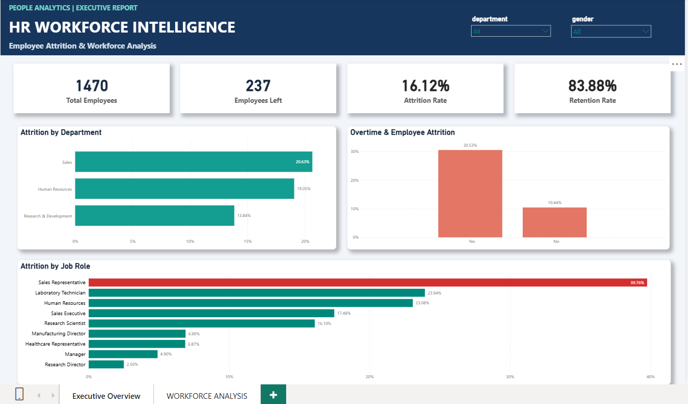
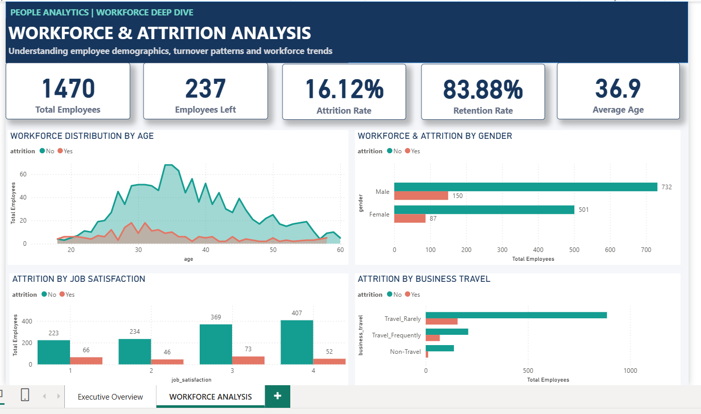

# 💼 IBM HR Workforce Analytics & Employee Attrition Intelligence

## 📌 Business Overview
Employee attrition poses a major challenge to organizational productivity and retention strategy. This end-to-end People Analytics project identifies key drivers behind employee turnover using **PostgreSQL** for exploratory data analysis and **Power BI** for executive dashboarding.

---

## 🛠️ Tech Stack & Methodology
* **Database Management:** PostgreSQL (Window Functions, CTEs, Aggregations, Data Filtering)
* **Data Visualization:** Power BI Desktop (DAX Measures, Data Modeling, Custom Formatting)
* **Data Source:** IBM HR Employee Attrition Dataset (1,470 Employee Records)

---

## 📊 Executive Dashboards

### Page 1: Executive Overview

### Page 2: Workforce Deep Dive

---

## 📊 Key Analytical Insights

1. **High-Risk Roles:** 
   * **Sales Representatives** exhibit the highest attrition rate at **39.76%**, followed by **Laboratory Technicians (23.94%)** and **Human Resources (23.08%)**.
2. **Impact of Overtime:** 
   * Employees working overtime suffer a **30.53% attrition rate**, compared to just **10.44%** for non-overtime staff (nearly 3x higher turnover risk).
3. **Departmental Attrition:**
   * The **Sales Department** leads total attrition at **20.63%**, followed closely by **Human Resources (19.05%)**.

---

## 💡 Strategic Business Recommendations

* **Role-Specific Retention:** Implement tailored career-progression pathways and compensation reviews specifically for Sales Representatives and Lab Technicians.
* **Workplace Overtime Caps:** Establish strict caps on weekly overtime hours to mitigate burnout, as overtime is the single strongest indicator of turnover.
* **Satisfaction & Engagement:** Introduce targeted employee feedback loops for teams rating low on job satisfaction (Levels 1 & 2).

---

## 📁 Repository Structure
